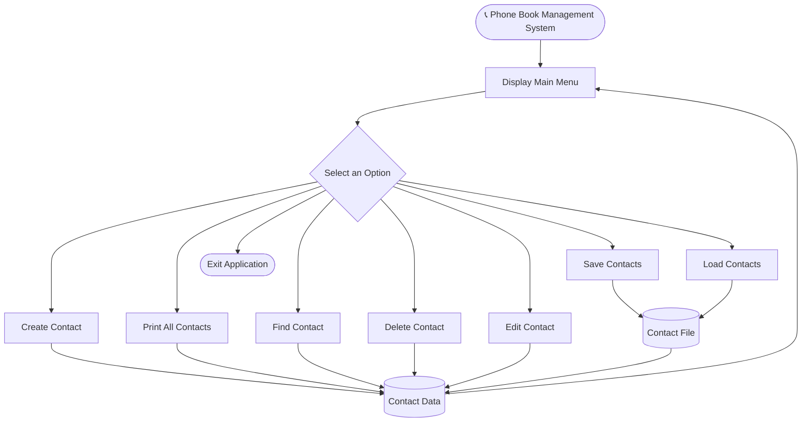

# 📞 Phone Book Management System

<h1 align="center">📞 Phone Book Management System</h1>

<p align="center">


</p>

## 📌 About the Project

The Phone Book Management System is a console-based application developed using the C programming language. It allows users to manage contact information, including names, multiple phone numbers, email addresses, and addresses.

This project uses structures, pointers, singly linked lists, dynamic memory allocation, modular programming, and file handling to manage and store contact information.

## ✨ Features

| Option | Operation | Description |
|---|---|---|
| `C` | Create Contact | Create a new contact with multiple phone numbers and email addresses |
| `P` | Print Contacts | Display all available contacts |
| `F` | Find Contact | Search for a contact using the name |
| `D` | Delete Contact | Delete a contact using the name |
| `E` | Edit Contact | Modify existing contact information or add new details |
| `S` | Save Contacts | Save all contact information into a file |
| `L` | Load Contacts | Load previously saved contact information |
| `R` | Exit | Exit the application |

## 🔄 Project Flow



## 🛠️ Technologies Used

- C Programming Language
- GCC Compiler
- Makefile
- Linux / Ubuntu

## 🧠 C Concepts Used

- Structures
- Pointers
- Singly Linked Lists
- User-Defined Functions
- Dynamic Memory Allocation (`malloc()` and `free()`)
- String Handling
- File Handling
- Modular Programming

## 📁 Project Structure

```text
Phone-Book-Management-System/
│
├── main.c
├── create.c
├── operations.c
├── phone_book.h
├── Makefile
└── README.md
```

### File Description

- `main.c` – Contains the main function and menu-driven interface.
- `create.c` – Contains the contact creation function.
- `operations.c` – Contains print, find, delete, edit, save and load functions.
- `phone_book.h` – Contains structure definitions, macros and function declarations.
- `Makefile` – Used to compile multiple source files.

## ⚙️ Compilation and Execution

Open the terminal in the project directory.

**Compile the project:**

```bash
make
```

**Run the application:**

```bash
./a.out
```

**Clean object files and executable:**

```bash
make clean
```

## 📝 Makefile

```makefile
a.out: main.o create.o operations.o
	gcc main.o create.o operations.o -o a.out

main.o: main.c phone_book.h
	gcc -c main.c

create.o: create.c phone_book.h
	gcc -c create.c

operations.o: operations.c phone_book.h
	gcc -c operations.c

clean:
	rm -f *.o a.out
```

---

# 💻 Sample Output

## 1. Create New Contacts

```text
--------CREATE NEW Contact--------

enter the name:Arti
enter the phone number:9579682714
enter the choice for new contact(Y/N):y
enter the another phone no to the same contact:9347357738
enter the choice for new contact(Y/N):n

enter the email:arti@12gmail.com
enter the choice for new email(Y/N):y
enter the another email id to the same contact:artidhoran@1gmail.com
enter the choice for new email(Y/N):n

enter the adress:Buldhana
```

## 2. Display All Contacts

```text
--------DISPLAY INFORMATION--------

PERSON:1:
person name:Arti
per_con_no:9579682714  9347357738
email id:arti@12gmail.com  artidhoran@1gmail.com
address:Buldhana

PERSON:2:
person name:Monika
per_con_no:9271427343  3977487489  3847972987
email id:monika@123gmail.com
address:Latur

PERSON:3:
person name:Shrutika
per_con_no:9387435093  8375649398  4873386333  9874362364  8943734787
email id:shrutika@132gmail.com
address:Amravti

PERSON:4:
person name:Tanvi
per_con_no:9238839128  9379871998
email id:tanvi@123
address:latur

PERSON:5:
person name:Sakshi
per_con_no:8379327327
email id:sakshi@123
address:sakshi@123
```

## 3. Search Contact

```text
--------SEARCH CONATCT--------

enter the name:Arti

Arti  9579682714  9347357738
arti@12gmail.com  artidhoran@1gmail.com
Buldhana
```

## 4. Delete Contact

```text
--------DELETE CONTACT--------

enter the name:Sakshi

cantact deleted successfully...
```

## 5. Edit Contact

**Edit Contact Name: Arti to Aarti**

```text
--------EDIT CONTACT--------

enter the name:Arti

1 name 2.phone 3.add_another_no
4.email 5.add another email 6.edit_address

enter the choice:1
enter the name:Aarti
```

**Add Another Email to Monika**

```text
--------EDIT CONTACT--------

enter the name:Monika

1 name 2.phone 3.add_another_no
4.email 5.add another email 6.edit_address

enter the choice:5
enter the email:monika87@gmail.com
```

## 6. Save Contact Information

```text
--------SAVE CONTACT--------

store information successfully...
```

## 7. Load Contact Information

The application provides a Load Contacts option to retrieve previously saved contact information from the file.

## 🚀 Future Enhancements

The following features can be added in future versions:

1. Add contact sorting functionality.
2. Improve phone number and email validation.
3. Add more contact details.
4. Improve duplicate contact validation.
5. Add contact import and export functionality.
6. Develop a graphical user interface (GUI).
7. Improve file handling and error management.

## 👩‍💻 Author

**Arti Rajendra Towane**

## 📌 Project Purpose

This project was developed to practice and understand C programming concepts, especially structures, pointers, linked lists, dynamic memory allocation, modular programming, and file handling.
